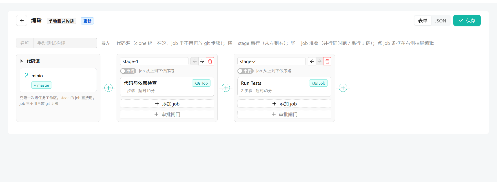
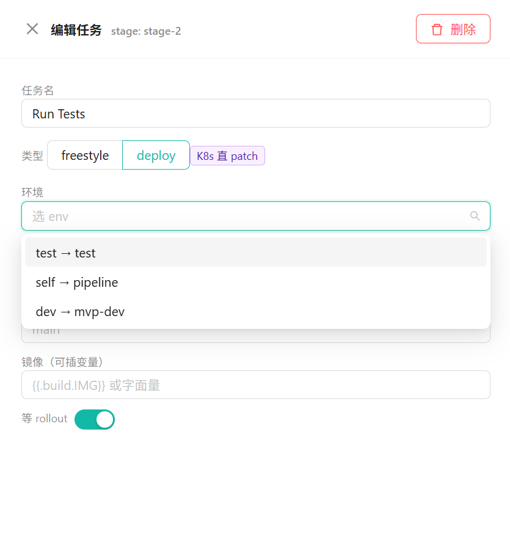
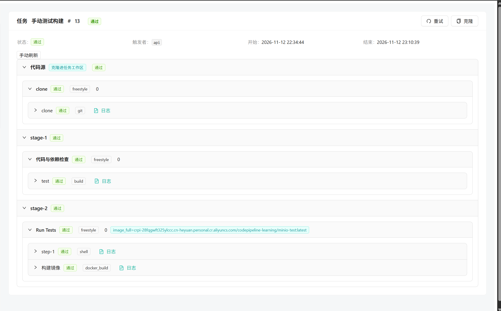
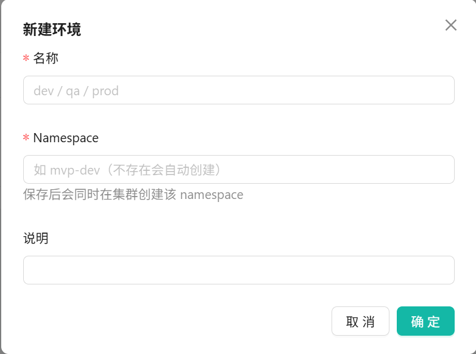
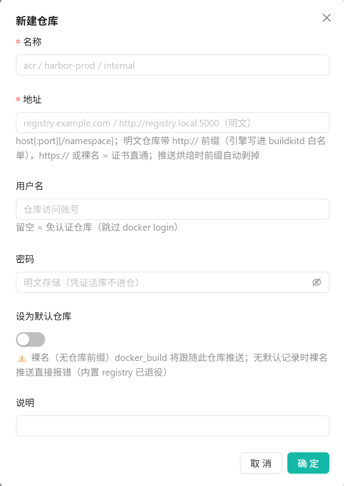

# mini-pipeline

小而全的云原生 CI/CD 平台——在网页上画一条流水线，从代码提交到应用上线，全自动跑完。
单体 Go 服务跑在 K8s 里，React 控制台独立部署，helm 一键装好全家桶。

> 刻意保持克制：单集群、轻量部署，聚焦核心发布链路。

## 界面预览



| 部署任务配置 | 任务详情与分步日志 |
|:---:|:---:|
|  |  |

| 环境管理 | 镜像仓库管理 |
|:---:|:---:|
|  |  |

## 产品能力

- **画布编排**：左侧代码源、横向串阶段、纵向排作业；五类步骤（脚本 / 编译构建 / 镜像构建 / 测试报告 / 产物归档）表单化填写，JSON 模式兜底
- **自动触发**：推送代码（webhook）、定时（cron）、手动三种入口，触发即跑
- **构建与发布**：镜像构建后自动推送仓库，产出名直通下游引用；部署作业直改 K8s Deployment 并盯完滚动更新，也可 ssh 到远程主机操作
- **环境与资源**：环境（namespace 自动创建）、镜像仓库（明文/公信自适应，可设默认）、远程主机（ssh）页内管理，凭证不落任务档案
- **质量与安全门禁**：junit 通过率卡点，低于阈值即失败；关键阶段人工审批放行（any/all）
- **过程可见**：stage → job → step 三级状态树 + 分步日志，每次运行都是完整档案——可克隆重跑、失败重试、随时取消
- **中断无忧**：暂停即落库存档，引擎重启不丢现场，审批后原地续跑
- **自举彩蛋**：内置图纸「用流水线发布流水线自身」——线上跑的引擎就是它自己构建、推送、发布的

## 技术栈

| 层 | 选型 |
|---|---|
| 后端 | Go · gin · MongoDB · client-go（单体服务，依赖单向分层） |
| 执行 | 每个作业 = 一个 K8s Job 沙箱；镜像构建走共享 buildkitd 构建池 |
| 存储 | MongoDB：流水线图纸、任务档案、产物文件 |
| 前端 | React 18 · TypeScript · antd 5 · Vite（独立 nginx 容器） |
| 交付 | helm chart 一键全家桶：引擎 / 数据库 / 构建池 / 前端 |

## 快速开始

```bash
helm install mini-pipeline oci://ghcr.io/edward-258/mini-pipeline --version 0.7.15 -n pipeline --create-namespace \
  --set image.repo=<registry>/<ns> \
  --set runner.image=<registry>/<ns>/pipeline-runner:<tag> \
  --set web.image=<registry>/<ns>/mini-pipeline-web:<tag> \
  --set ingress.host=<域名>

open https://<域名>    # 浏览器直接开
```

镜像源与域名均在部署期指定，仓库不含任何端点与凭证；完整前置清单见 `deploy/chart/mini-pipeline/values.yaml` 顶部注释。

## 设计理念

**图纸/实例分离**：运行时全量快照，改图纸不影响在跑的任务。**durable 暂停**：暂停即存档，跨重启可续。**Job = K8s Job**：引擎只负责编排，执行交给集群。
